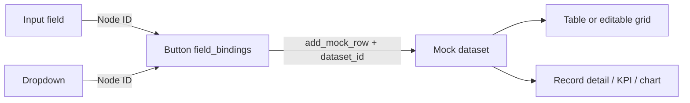
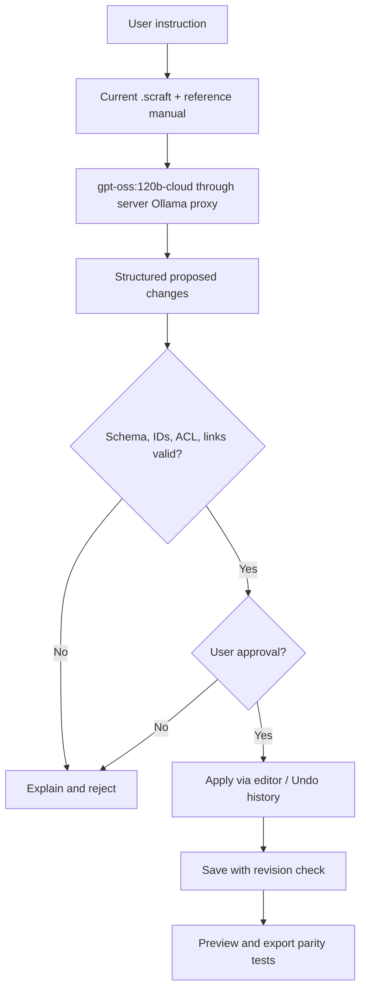

# ScreenCraft — online help and object reference

> This help is based on the pinned canonical catalogue **1.0.0** from `zageabb/Application-Standard/standards/screencraft/object-catalogue.json`. Runtime behaviour must be verified against the current editor, and offline HTML export parity checked for each new feature. The demo uses synthetic data only.

## Get started

1. Open **Applications**, select a project, then choose **Design**.
2. Drag an object from **Object Gallery** onto the canvas. Click it to edit its properties in the right panel.
3. Use **Layers** to select nested objects; choose a parent container for grouped layouts.
4. Configure datasets and input field bindings under Table sample data / button actions.
5. Switch to **Preview** to exercise navigation, data-entry, modals and table actions.
6. **Save**, then download **.scraft** or **Interactive HTML**. Test the exported HTML as well.

## Screens and layout

A screen is a viewport plus an ordered collection of nodes. Rename, reorder and delete screens in the screen list. Navigation refers to stable screen IDs, not labels. The canvas supports drag, resize, nesting, overflow and theme colours. Set parent_id only to valid containers, avoiding cycles. Use Undo and Redo before saving.

## Object catalogue — 39 entries

### Content

#### `text` — Static or dynamic textual content

Use for headings, labels, instructions and output. Edit props.text; position using layout; foreground/background through style or a theme token. Does not accept child objects. Property groups: `props.text`, `style`, `layout`.

#### `image` — Packaged media

Display a packaged image asset with appropriate alt text; verify it persists in .scraft. Does not accept child objects. Property groups: `props.asset_id`, `props.alt`, `style`.

### Inputs

#### `button` — Trigger an action or navigation

Runs a declarative prototype action. Set action.type and target_screen, target_node, dataset_id and field_bindings as applicable. Test in Preview and standalone HTML. Does not accept child objects. Property groups: `props.label`, `action`, `disabled`, `style`.

#### `input` — Text or numeric entry

Single-line text. Use a unique node ID as source in action.field_bindings; set placeholder, required and length rules. Does not accept child objects. Property groups: `props.label`, `props.placeholder`, `bindings`, `validation`.

#### `select` — Choose a value from defined options

Dropdown with props.options. Its selected value can feed a button field binding. Does not accept child objects. Property groups: `props.options`, `props.value`, `bindings`.

#### `checkbox` — Boolean selection

True/false input. Its checked state can feed a dataset column through field_bindings. Does not accept child objects. Property groups: `props.label`, `props.checked`, `bindings`.

#### `x-number` — x-number extension object

Numeric value input suitable for validated form-to-dataset bindings. Does not accept child objects. Property groups: `props`, `layout`, `style`, `bindings`, `action`.

#### `x-date` — x-date extension object

Date input; bind a row column through field_bindings. Does not accept child objects. Property groups: `props`, `layout`, `style`, `bindings`, `action`.

#### `x-time` — x-time extension object

Time input; preview-only input values unless bound to an action. Does not accept child objects. Property groups: `props`, `layout`, `style`, `bindings`, `action`.

#### `x-radio` — x-radio extension object

Single choice from props.options; bind like dropdown. Does not accept child objects. Property groups: `props`, `layout`, `style`, `bindings`, `action`.

#### `x-toggle` — x-toggle extension object

Boolean on/off control; bind as a checkbox. Does not accept child objects. Property groups: `props`, `layout`, `style`, `bindings`, `action`.

#### `x-file-upload` — x-file-upload extension object

Local prototype file selection/preview, not permanent server storage. Does not accept child objects. Property groups: `props`, `layout`, `style`, `bindings`, `action`.

#### `x-search` — x-search extension object

Filters compatible data widgets; configure its target table/data source. Does not accept child objects. Property groups: `props`, `layout`, `style`, `bindings`, `action`.

#### `x-textarea` — x-textarea extension object

Multiline field; bind by input object ID. Does not accept child objects. Property groups: `props`, `layout`, `style`, `bindings`, `action`.

### Data

#### `table` — Tabular data and optional mock interactions

Read/display dataset rows. Assign props.dataset_id; edit schema and seed rows in the table inspector. Supports nested children. Property groups: `props.dataset_id`, `props.columns`, `bindings`.

#### `x-editable-grid` — x-editable-grid extension object

Table with interactive cell editing in supported preview mode; configure dataset, columns and rows. Supports nested children. Property groups: `props`, `layout`, `style`, `bindings`, `action`.

#### `x-tree` — x-tree extension object

Hierarchical dataset view; configure id_column, parent_column and label_column. Supports nested children. Property groups: `props`, `layout`, `style`, `bindings`, `action`.

#### `x-list` — x-list extension object

Rows as list items; point at a dataset and label_column. Supports nested children. Property groups: `props`, `layout`, `style`, `bindings`, `action`.

#### `x-record-detail` — x-record-detail extension object

Details for selected table row; align dataset_id and source_table_id. Supports nested children. Property groups: `props`, `layout`, `style`, `bindings`, `action`.

#### `x-kpi` — x-kpi extension object

A single measure; set label, aggregate type or value. Does not accept child objects. Property groups: `props`, `layout`, `style`, `bindings`, `action`.

#### `x-chart` — x-chart extension object

Visualises dataset aggregates; choose chart_type and data/measure. Does not accept child objects. Property groups: `props`, `layout`, `style`, `bindings`, `action`.

#### `x-pagination` — x-pagination extension object

Paging control linked via target_table_id to a table or grid. Does not accept child objects. Property groups: `props`, `layout`, `style`, `bindings`, `action`.

### Layout

#### `container` — Generic container with nested components

Group children; use parent_id to nest and adjust layout mode, overflow, size and collapse behaviour. Supports nested children. Property groups: `layout`, `style`, `children`.

#### `x-card` — x-card extension object

Decorative card with nested content and theme-aware styling. Supports nested children. Property groups: `props`, `layout`, `style`, `bindings`, `action`.

#### `x-grid` — x-grid extension object

Layout children in grid mode rather than freeform coordinates. Supports nested children. Property groups: `props`, `layout`, `style`, `bindings`, `action`.

#### `x-flex` — x-flex extension object

Align and distribute children along a flex layout. Supports nested children. Property groups: `props`, `layout`, `style`, `bindings`, `action`.

#### `x-splitter` — x-splitter extension object

Resizing/split layout regions; nest content and set split_percent. Supports nested children. Property groups: `props`, `layout`, `style`, `bindings`, `action`.

#### `x-sidebar` — x-sidebar extension object

Side region for navigation, filtering or actions; combine with collapsible behaviour. Supports nested children. Property groups: `props`, `layout`, `style`, `bindings`, `action`.

#### `x-accordion` — x-accordion extension object

Expandable details area; set expanded and nest related content. Supports nested children. Property groups: `props`, `layout`, `style`, `bindings`, `action`.

### Navigation

#### `tabs` — Switch between labelled panels

Panels switched by tab_labels; children assigned by section/panel to maintain logical grouping. Supports nested children. Property groups: `props.tabs`, `action`.

#### `x-menu` — x-menu extension object

Local/shared navigation menu with target_screen routes. Supports nested children. Property groups: `props`, `layout`, `style`, `bindings`, `action`.

#### `x-breadcrumbs` — x-breadcrumbs extension object

Shows screen path and enables navigation back. Supports nested children. Property groups: `props`, `layout`, `style`, `bindings`, `action`.

#### `x-toolbar` — x-toolbar extension object

Horizontal group for buttons, search and navigation. Supports nested children. Property groups: `props`, `layout`, `style`, `bindings`, `action`.

#### `x-wizard` — x-wizard extension object

Multi-step form with tab_labels; group child inputs per step. Supports nested children. Property groups: `props`, `layout`, `style`, `bindings`, `action`.

### Overlay

#### `modal` — Dialog with nested content

Overlay opened by a button action targeting the modal node; always provide a close route. Supports nested children. Property groups: `props.title`, `action`, `layout`.

### Advanced

#### `x-schema-map` — x-schema-map extension object

Diagram of tables/fields/links used in schema modelling. Supports nested children. Property groups: `props`, `layout`, `style`, `bindings`, `action`.

#### `x-timeline` — x-timeline extension object

Chronological items from dataset; configure date_column and title_column. Supports nested children. Property groups: `props`, `layout`, `style`, `bindings`, `action`.

#### `x-file-preview` — x-file-preview extension object

Client-side preview of selected file types; do not claim upload persistence. Does not accept child objects. Property groups: `props`, `layout`, `style`, `bindings`, `action`.

#### `x-diagram` — x-diagram extension object

Connect labelled nodes visually; links are visual unless wired through an action. Supports nested children. Property groups: `props`, `layout`, `style`, `bindings`, `action`.


## Wiring objects to one another

Use **stable node IDs** to connect events and values. A button's `action.field_bindings` maps each dataset column ID to an input node ID, e.g.:

```json
{"type":"add_mock_row","dataset_id":"contacts","field_bindings":{"name":"name-input","status":"status-select"}}
```

Set the table's `props.dataset_id` to `contacts`, and ensure the dataset has columns `name` and `status`. In Preview, the Add button reads live input values into the new mock row. `action.values` provides optional defaults. An input's display label is **not** its binding ID. Keep bindings intact when renaming labels.

Other links: `navigate` uses `target_screen`; `open_modal` uses `target_node`; pagination, search and record-detail objects use configured source/target IDs; hierarchy uses `parent_id`. Avoid references to deleted objects.



## AI design assistant

The floating assistant is intended to answer questions using this manual and the object catalogue, inspect the **current design document**, diagnose disconnected bindings, suggest new objects, align or arrange them, and propose wiring. Its plan is a previewable set of changes. The user must approve changes before they affect the document; Preview-only data is excluded. AI is **not** authorised to edit the demo, bypass ACLs, write to production databases, call arbitrary APIs, or publish projects.



## Demo and permissions

**ScreenCraft Object Gallery Demo** is a permanent shared, read-only example. All authenticated users may open and Preview it. Nobody can alter the original through editor, HTTP API, AI or upload. To customise examples, create a separate project from exported demo content.

## Export troubleshooting

If Preview works but Interactive HTML fails, report an export-parity defect. If a table renders without values, confirm its dataset_id, columns and seed rows. If a bound button creates blanks, verify its field_bindings refer to the *input node IDs* on the current screen, and that all corresponding dataset column IDs exist. If a colour appears wrong, check object overrides before theme tokens. If imported objects seem unsupported, check the canonical catalogue snapshot and current supported renderer before changing the .scraft format.

## Ollama deployment

Configure `SCREENCRAFT_OLLAMA_URL=http://192.168.1.249:11434` on the **ScreenCraft backend**, not in browser JS. Configure `SCREENCRAFT_OLLAMA_MODEL=gpt-oss:120b-cloud`. Backend must reach the host over the trusted private network; no internet-exposed Ollama port, no client-controlled URL, and no credentials inside .scraft or prompts. Check Ollama model availability, timeouts and privacy settings before enabling. Hosted/cloud model routing may transmit design text beyond the LAN; do not send confidential designs unless explicitly authorised.
